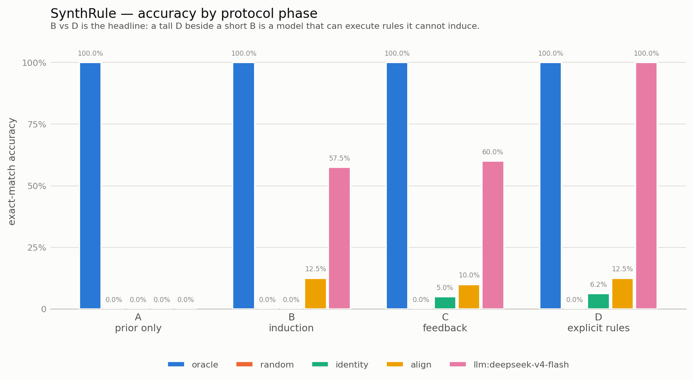

# SynthRule — 运行结果 / Run Report

- **模型 / Model:** llm:deepseek-v4-flash
- **随机种子 / Seed:** `20260931`
- **任务数 / Tasks:** 8 (6 novel + 2 contamination-probe)
- **计分条目 / Scored items:** 560
- **每题示例数 / Support examples:** 4
- **难度梯度 / Difficulty tiers:** [4, 5, 6] rules
- **字母表 / Alphabets:** pseudoword, glyph, latin

## 1. 各阶段准确率（精确匹配，95% Wilson 区间）

| Agent | Phase A prior only | Phase B induction | Phase C feedback | Phase D explicit rules | Phase D − B |
|---|---|---|---|---|---|
| `oracle` | **100.0%** 80.6%–100.0% | **100.0%** 91.2%–100.0% | **100.0%** 91.2%–100.0% | **100.0%** 80.6%–100.0% | **+0.000** |
| `random` | **0.0%** 0.0%–19.4% | **0.0%** 0.0%–8.8% | **0.0%** 0.0%–8.8% | **0.0%** 0.0%–19.4% | **+0.000** |
| `identity` | **0.0%** 0.0%–19.4% | **0.0%** 0.0%–8.8% | **5.0%** 1.4%–16.5% | **6.2%** 1.1%–28.3% | **+0.062** |
| `align` | **0.0%** 0.0%–19.4% | **12.5%** 5.5%–26.1% | **10.0%** 4.0%–23.1% | **12.5%** 3.5%–36.0% | **+0.000** |
| `llm:deepseek-v4-flash` | **0.0%** 0.0%–19.4% | **57.5%** 42.2%–71.5% | **60.0%** 44.6%–73.7% | **100.0%** 80.6%–100.0% | **+0.425** |

> 表中准确率以**全部计分条目**为分母；被 harness 截断而无法作答的条目记为 0。下表给出**仅计已作答条目**的准确率 —— 若两表一致，说明没有条目被截断。

## 2. 仅计已作答条目的准确率

| Agent | Phase A | Phase B | Phase C | Phase D | Unparsed / total |
|---|---|---|---|---|---|
| `oracle` | 100.0% | 100.0% | 100.0% | 100.0% | 0 / 112 |
| `random` | 0.0% | 0.0% | 0.0% | 0.0% | 0 / 112 |
| `identity` | 0.0% | 0.0% | 5.0% | 6.2% | 0 / 112 |
| `align` | 0.0% | 12.5% | 10.0% | 12.5% | 0 / 112 |
| `llm:deepseek-v4-flash` | 0.0% | 79.3% | 80.0% | 100.0% | 21 / 112 |

## 3. 派生指标（按任务 bootstrap 95% 区间）

| Agent | learning gain B − A | feedback gain late C − early C | induction gap D − B |
|---|---|---|---|
| `oracle` | +0.000 [+0.00, +0.00] | +0.000 [+0.00, +0.00] | +0.000 [+0.00, +0.00] |
| `random` | +0.000 [+0.00, +0.00] | +0.000 [+0.00, +0.00] | +0.000 [+0.00, +0.00] |
| `identity` | +0.000 [+0.00, +0.00] | -0.021 [-0.19, +0.12] | +0.062 [+0.00, +0.19] |
| `align` | +0.125 [+0.00, +0.28] | -0.042 [-0.08, +0.00] | +0.000 [-0.04, +0.04] |
| `llm:deepseek-v4-flash` | +0.575 [+0.40, +0.72] | +0.062 [-0.19, +0.31] | +0.425 [+0.27, +0.60] |

## 4. 按难度分层

**难度 = 规则条数**

| Value | Phase A | Phase B | Phase C | Phase D |
|---|---|---|---|---|
| `oracle` · 4 | 100.0% | 100.0% | 100.0% | 100.0% |
| `oracle` · 5 | 100.0% | 100.0% | 100.0% | 100.0% |
| `oracle` · 6 | 100.0% | 100.0% | 100.0% | 100.0% |
| `random` · 4 | 0.0% | 0.0% | 0.0% | 0.0% |
| `random` · 5 | 0.0% | 0.0% | 0.0% | 0.0% |
| `random` · 6 | 0.0% | 0.0% | 0.0% | 0.0% |
| `identity` · 4 | 0.0% | 0.0% | 0.0% | 16.7% |
| `identity` · 5 | 0.0% | 0.0% | 6.7% | 0.0% |
| `identity` · 6 | 0.0% | 0.0% | 10.0% | 0.0% |
| `align` · 4 | 0.0% | 20.0% | 13.3% | 16.7% |
| `align` · 5 | 0.0% | 0.0% | 0.0% | 0.0% |
| `align` · 6 | 0.0% | 20.0% | 20.0% | 25.0% |
| `llm:deepseek-v4-flash` · 4 | 0.0% | 60.0% | 66.7% | 100.0% |
| `llm:deepseek-v4-flash` · 5 | 0.0% | 46.7% | 53.3% | 100.0% |
| `llm:deepseek-v4-flash` · 6 | 0.0% | 70.0% | 60.0% | 100.0% |

## 5. 按字母表分层（tokenization 混淆检查）

**字母表家族**

| Value | Phase A | Phase B | Phase C | Phase D |
|---|---|---|---|---|
| `oracle` · glyph | 100.0% | 100.0% | 100.0% | 100.0% |
| `oracle` · latin | 100.0% | 100.0% | 100.0% | 100.0% |
| `oracle` · pseudoword | 100.0% | 100.0% | 100.0% | 100.0% |
| `random` · glyph | 0.0% | 0.0% | 0.0% | 0.0% |
| `random` · latin | 0.0% | 0.0% | 0.0% | 0.0% |
| `random` · pseudoword | 0.0% | 0.0% | 0.0% | 0.0% |
| `identity` · glyph | 0.0% | 0.0% | 10.0% | 0.0% |
| `identity` · latin | 0.0% | 0.0% | 5.0% | 0.0% |
| `identity` · pseudoword | 0.0% | 0.0% | 0.0% | 25.0% |
| `align` · glyph | 0.0% | 0.0% | 0.0% | 0.0% |
| `align` · latin | 0.0% | 25.0% | 20.0% | 25.0% |
| `align` · pseudoword | 0.0% | 0.0% | 0.0% | 0.0% |
| `llm:deepseek-v4-flash` · glyph | 0.0% | 40.0% | 40.0% | 100.0% |
| `llm:deepseek-v4-flash` · latin | 0.0% | 70.0% | 65.0% | 100.0% |
| `llm:deepseek-v4-flash` · pseudoword | 0.0% | 50.0% | 70.0% | 100.0% |

## 6. 训练数据污染探针

| Agent | Novel B | Familiar B | familiar_delta (B) | Novel D | Familiar D |
|---|---|---|---|---|---|
| `oracle` | 100.0% | 100.0% | **+0.000** | 100.0% | 100.0% |
| `random` | 0.0% | 0.0% | **+0.000** | 0.0% | 0.0% |
| `identity` | 0.0% | 0.0% | **+0.000** | 8.3% | 0.0% |
| `align` | 6.7% | 30.0% | **+0.233** | 8.3% | 25.0% |
| `llm:deepseek-v4-flash` | 53.3% | 70.0% | **+0.167** | 100.0% | 100.0% |

> `familiar_delta` = 熟悉字母表上的 B 阶段准确率 − 陌生字母表上的 B 阶段准确率。显著为正说明模型在见过的变换上更强，即存在检索优势而非学习优势。

## 7. 运行健康度

| Agent | Items | Unparsed | Truncated responses |
|---|---|---|---|
| `oracle` | 112 | 0 | 0 |
| `random` | 112 | 0 | 0 |
| `identity` | 112 | 0 | 0 |
| `align` | 112 | 0 | 0 |
| `llm:deepseek-v4-flash` | 112 | 21 | 21 |

> `Unparsed` = 无法从回复中解析出答案；`Truncated` = 回复因 `max_tokens` 被截断。两者必须与「模型答错」区分开 —— 若截断数偏高，准确率是系统性低估的。

## 8. Token 用量

| Agent | Calls | Errors | Truncated | Input | Output | Total |
|---|---|---|---|---|---|---|
| `llm:deepseek-v4-flash` | 170 | 0 | 79 | 34,212 | 2,714,564 | 2,748,776 |
