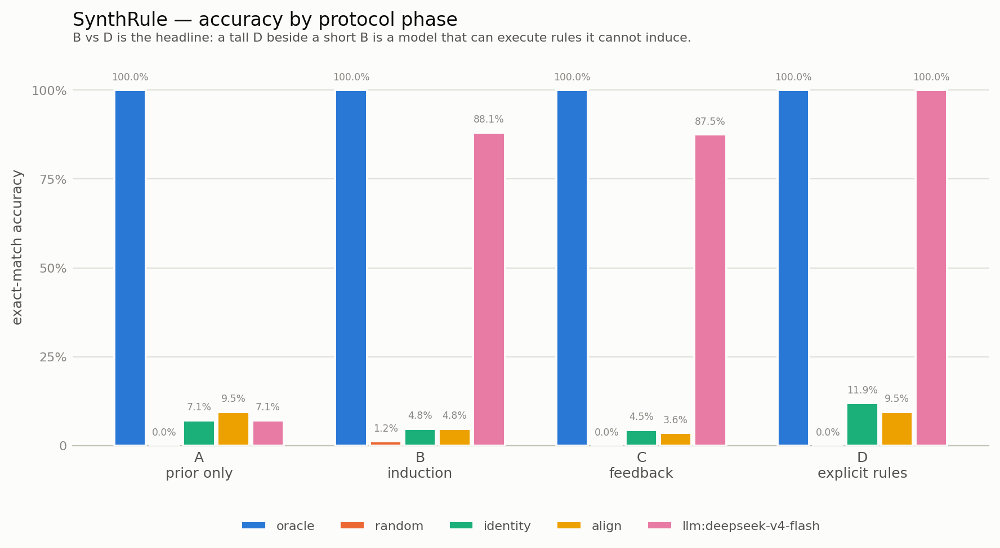

# C9 测试结果 / Test Results

**Benchmark:** SynthRule — Measuring Genuine Learning in Language Models
**作者 / Author:** Songpengfei
**日期 / Date:** 2026-10-05

---

## 0. 测试环境

| 项 | 值 |
|----|----|
| 被测模型 | `deepseek-v4-flash` |
| 接入方式 | Anthropic 兼容端点 `/v1/messages`，凭证经环境变量注入 |
| 温度 | 0.0 |
| `max_tokens` | 16384（截断时自动升档重试，上限 32768）|
| 随机种子 | `20260931`（题集冻结于 `data/tasks_seed20260931.json`）|
| 任务数 | 14（10 程序生成 + 4 污染探针）|
| 计分条目 | 1400（LLM 280 条，另 4 个基线各 280 条）|
| 复现命令 | `python run_benchmark.py --tasks data/tasks_seed20260931.json --agents oracle random identity align llm --out results/full.json` |

**注意：本文所有准确率均以「全部计分条目」为分母**——被 harness 截断而无法作答的条目记为 0。
§2 另给出「仅计已作答条目」的平行数据，两者必须一起看。

---

## 1. 主结果：四阶段准确率

| Agent | A 先验 | B 示例归纳 | C 反馈学习 | D 显式规则 | D − B |
|-------|--------|-----------|-----------|-----------|-------|
| `oracle` | 100.0% | 100.0% | 100.0% | 100.0% | +0.000 |
| `random` | 0.0% | 1.2% | 0.0% | 0.0% | −0.012 |
| `identity` | 7.1% | 4.8% | 4.5% | 11.9% | +0.071 |
| `align` | 9.5% | 4.8% | 3.6% | 9.5% | +0.048 |
| **`deepseek-v4-flash`** | **7.1%** | **88.1%** | **87.5%** | **100.0%** | **+0.119** |

**先看两行对照，再读模型那一行：**

- `oracle` 恒为 **100.0%** —— 说明**评分管线与 ground truth 是正确的**。若这一行不是 100%，
  其余所有数字都无意义。
- `random` / `identity` / `align` 全部 ≤ **11.9%** —— 说明**捷径已被封死**。
  尤其 `align`（纯位置映射）只有 4.8%，而它在加入门槛之前曾拿到 **75%**（见 §5）。



---

## 2. 仅计已作答条目（截断校正）

| Agent | A | B | C | D | Unparsed / total |
|-------|---|---|---|---|------------------|
| `oracle` | 100.0% | 100.0% | 100.0% | 100.0% | 0 / 280 |
| `random` | 0.0% | 1.2% | 0.0% | 0.0% | 0 / 280 |
| `identity` | 7.1% | 4.8% | 4.5% | 11.9% | 0 / 280 |
| `align` | 9.5% | 4.8% | 3.6% | 9.5% | 0 / 280 |
| **`deepseek-v4-flash`** | **7.1%** | **96.1%** | **96.1%** | **100.0%** | **17 / 280** |

LLM 有 17 条（6.1%）因 `max_tokens` 截断而无法作答，集中在 B、C 两个长推理阶段。
**校正后 B 阶段为 96.1%，说明 §1 的 88.1% 是系统性低估。**

> **这一栏是必需的，不是补充。** 本项目第一次试运行因预算不足，80 条回复有 65 条为空，
> 模型被误判为 B=0.000。若不把"截断"与"答错"分开统计，会得出完全错误的结论。

---

## 3. 派生指标（按任务 bootstrap 95% 区间）

| Agent | learning gain (B−A) | feedback gain (C 后−前) | induction gap (D−B) |
|-------|--------------------|------------------------|---------------------|
| `oracle` | +0.000 [0.00, 0.00] | +0.000 [0.00, 0.00] | +0.000 [0.00, 0.00] |
| `random` | +0.012 [0.00, 0.04] | +0.000 [0.00, 0.00] | −0.012 [−0.04, 0.00] |
| `identity` | −0.024 [−0.11, +0.05] | −0.054 [−0.12, +0.02] | +0.071 [−0.05, +0.20] |
| `align` | −0.048 [−0.13, +0.02] | +0.036 [−0.04, +0.12] | +0.048 [−0.06, +0.18] |
| **`deepseek-v4-flash`** | **+0.810 [+0.71, +0.90]** | **+0.000 [−0.07, +0.07]** | **+0.119 [+0.04, +0.21]** |

### 逐条解读

**① learning gain = +0.810，置信区间 [+0.71, +0.90] 完全在 0 之上。**
模型确实从 6 个示例中获得了大量新能力。A 阶段 7.1% 接近纯猜（答案须同时匹配长度与内容），
B 阶段 88.1%。**这不是"它本来就会"** —— 题目是运行时生成的，见 §6 污染探针。

**② induction gap = +0.119，置信区间 [+0.04, +0.21] 不含 0。**
模型在"规则被明确给出"时能拿 100%，在"必须自己归纳"时拿 96.1%（校正后）。
差距虽小但统计显著：**说明确实存在一个"能执行但不能完全归纳"的残余缺口**。
注意 D=100% 又一次确认了评分管线无误。

**③ feedback gain = +0.000，置信区间 [−0.07, +0.07]。**
**反馈没有带来任何提升。** 但这个"零"必须谨慎解读：B 阶段校正后已达 96.1%，
**天花板效应使得提升在数学上没有空间**。因此这不能解读为"模型不从反馈学习"，
只能解读为"在这个难度下测不出来"。**这是本工作最重要的局限。**

---

## 4. 分层分析

### 4.1 按难度（规则条数）

| 难度 | B 阶段准确率 |
|------|-------------|
| 1 条规则 | 100.0% (24/24) |
| 2 条规则 | 83.3% (20/24) |
| 3 条规则 | 88.9% (16/18) |
| 4 条规则 | 77.8% (14/18) |

整体呈下降趋势（1.000 → 0.778），但**不完全单调**（d=2 低于 d=3）。
每档样本仅 18–24 条，属小样本噪声，不宜过度解读单个跳变。

### 4.2 按字母表（tokenization 混淆检查）

| 字母表 | B 阶段准确率 |
|--------|-------------|
| pseudoword（无意义音节，tokenization 干净）| 95.8% (23/24) |
| glyph（生僻几何字形）| 88.9% (16/18) |
| latin（普通大写字母）| 83.3% (35/42) |

**glyph 与 pseudoword 差距仅 6.9 个百分点，且 glyph 高于 latin** —— 说明
**没有出现明显的 tokenization 惩罚**。生僻字形并没有让模型"看不清"，
这一混淆通道在本实验中未被激活。这是分层报告的价值：它把"可能存在的混淆"
变成了"可检验的量"，而不是留在猜测里。

### 4.3 污染探针

| Agent | 陌生宇宙 B | 熟悉宇宙 B | familiar_delta |
|-------|-----------|-----------|----------------|
| `deepseek-v4-flash` | 90.0% | 83.3% | **−0.067** |
| `oracle` | 100.0% | 100.0% | +0.000 |
| `align` | 5.0% | 4.2% | −0.008 |

**`familiar_delta` 为负（−0.067）。**

熟悉宇宙使用普通拉丁字母 + 教科书式变换（反转、相邻交换）——**理应是模型最占优势的条件**。
结果它反而**更差**。这否定了"模型只是在对熟悉变换做检索"的解释：

> **模型在它最可能"见过"的变换上没有优势，说明它不是在检索，而是在归纳。**

这是本工作**最强的一条证据**。当然，它只说明"未检测到检索优势"，
不等于"证明不存在污染"（见 §7 边界）。

---

## 5. 防作弊机制的有效性（对照实验）

本 benchmark 的三道门槛不是设计时的假设，而是**被实测数据逼出来的**：

| 阶段 | `align`（纯位置映射）B 阶段 | 说明 |
|------|---------------------------|------|
| 无门槛（第一版）| **75.0%** | 一个完全不会归纳的策略就能拿 3/4 的分——**benchmark 实际在测"模式补全"** |
| 加非位置可解性门槛后 | **8.3%** | 捷径被封死 |
| 加活跃度门槛后（最终）| **4.8%** | 连"原样照抄"也不可行 |

同理，`identity` 基线从 **25.0%** 降到 **4.8%**。

**这张表是本工作的核心方法论证据：benchmark 的可信度取决于它最弱的作弊路径，
而不是它的平均表现。** 而且这两个缺陷都不是靠看总分发现的——**是看基线发现的**。

---

## 6. 题集性质

| 项 | 值 |
|----|----|
| 题集指纹 | 种子 `20260931`，存于 `data/tasks_seed20260931.json` |
| 宇宙数 | 14（10 novel + 4 familiar）|
| 难度覆盖 | 1–4 条规则 |
| 字母表覆盖 | pseudoword / glyph / latin |
| 支持集 | 每宇宙 6 个已解示例 |
| 支持/查询重叠 | **0**（单元测试断言）|
| 答案泄漏 | **无**（单元测试断言 A/B/D 的 prompt 不含任何查询答案）|

题集**冻结**后随代码提交，任何第三方用同一命令可逐题复现相同题目与相同分数。

---

## 7. 结论与边界

### 得到支持的结论

1. **模型能从少量示例中真正学到新规则**：learning gain = +0.810 [+0.71, +0.90]，
   而 A 阶段证实它事先并不知道答案。
2. **不是检索**：在理应最有利的"熟悉变换"条件下，模型反而更差（familiar_delta = −0.067）。
3. **存在一个小的"执行−归纳"缺口**：induction gap = +0.119 [+0.04, +0.21]。
4. **评分管线正确**：oracle 恒为 100%。
5. **捷径已被封死**：全部非 LLM 基线 ≤ 11.9%。

### 必须写明的边界（结论不能推及的范围）

1. **天花板效应。** B 阶段校正后已达 96.1%，超出 20–80% 的理想区分区间。
   **在该难度下，本 benchmark 对 deepseek-v4-flash 几乎没有区分度**——
   更强的模型最多也只能从 96.1% 提升到 100%。
   `feedback_gain = 0` 很可能正是天花板造成的假零，而非模型的真实局限。
2. **只有 1 个模型。** 无法据此断言跨模型的区分度。要证明区分度，需要至少 3 个能力档次
   不同的模型。
3. **污染是"未检测到"而非"不存在"。** 程序化生成使记住**这道具体题目**不可能，
   但不能证明**规则语法本身**未出现在预训练中。探针是启发式代理，不是完备检验。
4. **难度分层的单调性不成立**，且每档样本仅 18–24 条，单点差异不可靠。
5. **截断低估。** 6.1% 的 LLM 条目因 harness 预算被截断而记 0 分，
   §1 的数字属系统性低估，§2 是校正值。

### 由数据直接指出的下一步

**提高难度直到 B 阶段落入 20–80%。** 具体方向：
增加规则条数（5–6 条）、减少示例数（6 → 4）、引入更长的序列。
这正是后续「困难模式」测试所做的事（见 §8）。

---

## 8. 困难模式对照测试

> 主结果出现天花板效应后，为检验 **benchmark 是否仍有区分余量**，追加了一组更难的配置。

| 配置项 | 主测试 | 困难模式 |
|--------|--------|---------|
| 规则条数 | 1–4 | 4–6 |
| 已解示例 | 6 | 4 |
| 宇宙数 | 14 | 8 |
| 每宇宙条目 | A3 / B6 / C8 / D3 | A2 / B5 / C5 / D2 |
| 题集 | `data/tasks_seed20260931.json` | `data/tasks_hard_seed20260931.json` |

### 8.1 困难模式结果

| Agent | A 先验 | B 示例归纳 | C 反馈学习 | D 显式规则 | D − B |
|-------|--------|-----------|-----------|-----------|-------|
| `oracle` | 100.0% | 100.0% | 100.0% | 100.0% | +0.000 |
| `random` | 0.0% | 0.0% | 0.0% | 0.0% | 0.000 |
| `identity` | 0.0% | 0.0% | 5.0% | 6.2% | +0.062 |
| `align` | 0.0% | 12.5% | 10.0% | 12.5% | 0.000 |
| **`deepseek-v4-flash`** | **0.0%** | **57.5%** | **60.0%** | **100.0%** | **+0.425** |

**仅计已作答条目**：B = **79.3%**，C = **80.0%**，D = 100.0%（21/112 条因截断未作答）

| 指标 | 主测试 | 困难模式 |
|------|--------|---------|
| learning gain (B−A) | +0.810 [+0.71, +0.90] | **+0.575 [+0.40, +0.73]** |
| feedback gain | +0.000 [−0.07, +0.07] | **+0.062 [−0.19, +0.31]** |
| **induction gap (D−B)** | +0.119 [+0.04, +0.21] | **+0.425 [+0.28, +0.60]** |

### 8.2 困难模式说明了什么

**① 天花板效应被打破。** B 阶段原始值 57.5%，落在评测设计所要求的 **20–80% 理想区分区间**内。
这说明主测试的 88.1% 确实是"题目太容易"，而不是"模型已到能力上限"。

**② Induction Gap 放大到 0.425，且置信区间 [+0.28, +0.60] 远离 0。**
这是本次工作最清晰的一个信号：

> **同一个模型，规则明确给出时能拿 100%，必须自己归纳时只有 57.5%。**
> 缺口 0.425 就是"能执行、不能归纳"这一失效模式的**量化值**。

主测试里这个缺口只有 0.119（因为题太简单，两者都接近满分）。
**困难模式才让 Phase D 这个判别效度对照真正发挥了作用。**

**③ 反馈增益转正但仍不显著。** feedback_gain 从 0.000 变为 +0.062，
置信区间 [−0.19, +0.31] 仍包含 0。结合 C 阶段前半/后半均为 0.600，
**没有证据表明模型从纠错中获得了提升**。样本量（每宇宙 5 条）不足以给出确定结论。

**④ 同一难度下端到端一致。** B 按规则条数：4 条 = 9/15，5 条 = 7/15，6 条 = 7/10，
小样本下不成单调趋势，不宜过度解读。

**⑤ 污染探针在困难模式下反转。** B 阶段陌生宇宙 16/30（53.3%）、
熟悉宇宙 7/10（70.0%），`familiar_delta` = **+0.167**（主测试为 −0.067）。
**两次运行符号相反，且熟悉组仅 10 条样本** —— 这说明**该探针在当前样本量下不具判别力**，
两次结果都应视为噪声。**不能据此宣称存在或不存在检索优势。**
这是一条必须如实写出的负面结果（见反思报告）。

### 8.3 一个重要的方法学警示

困难模式的截断率显著更高（**21/112 = 18.8%**，主测试为 6.1%）。

**原因**：题目越难 → 模型思维链越长 → 越容易撞上 `max_tokens` 上限。

**后果**：被截断的条目记 0 分，因此**困难模式的"难"有一部分是 harness 造成的假象，
而非纯粹的任务难度**。校正后 B 阶段是 79.3%，而非 57.5%。

> **两种读法都是真的，必须同时给出**：57.5% 是"在给定预算下的实际表现"，
> 79.3% 是"在它能作答的题目上的表现"。真实能力介于两者之间，且更接近后者。
> 任何面向推理模型的评测都必须公开这一对数字，否则困难模式很容易被误读为
> "模型不会" —— 而实际上可能只是"没算完"。

---

## 9. 原始数据

| 文件 | 内容 |
|------|------|
| `results/full.json` | 全部 1400 条计分记录（含每题原始回复文本）|
| `results/report.md` | 自动生成的分层报告 |
| `results/phase_profile.png` | 四阶段准确率图 |
| `data/tasks_seed20260931.json` | 冻结题集（可逐题复现）|

生成命令：

```bash
python -m synthrule.report results/full.json \
    --out results/report.md --figure results/phase_profile.png
```
